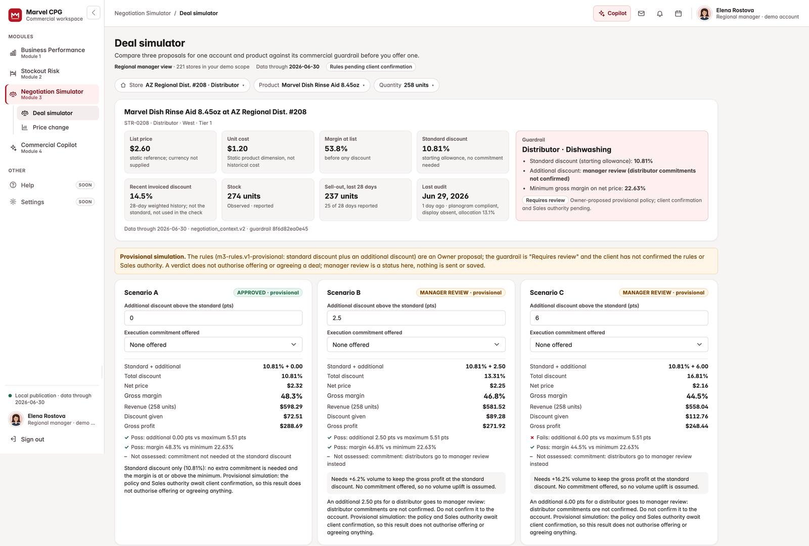
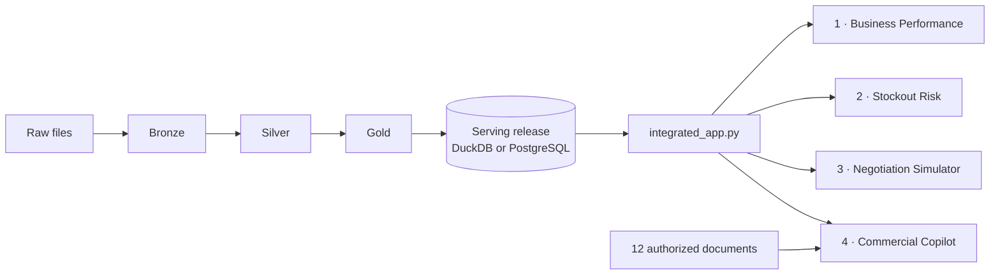

<div align="center">

# Marvel CPG Commercial Workspace

**From KPIs to the next store visit.**<br>
One workspace where regional managers and field sales reps see how their stores perform, which shelves will go
empty next week, whether a deal holds up, and get answers in plain English.


[Modules](#modules) · [Quick start](#quick-start) · [Architecture](#architecture) · [Deployment](#deployment) ·
[Tests](#tests) · [Status](#status-and-limitations) · [License](#license)


</div>

---

## Highlights

- **Four modules, one sign-in, one data release.** Business Performance, Stockout Risk, Negotiation Simulator
  and Commercial Copilot all read the same versioned data, so their numbers agree.
- **Role-aware by design.** A regional manager sees every store in scope; a field rep sees only their own stores.
  The Copilot's SQL is limited to the same stores.
- **Honest numbers.** Missing data is shown as unknown, never as zero; estimates are opt-in and labelled; a model
  that has not passed its release gate says so on the page.
- **Answers you can check.** Every Copilot answer comes with its chart, table and SQL, or with citations down to
  the document, section and PDF page.

---

## Modules

<table>
<tr>
<td width="50%" valign="top">

### 1 · Business Performance

- Five KPIs: MSL compliance, out-of-stock rate, sell-in vs sell-out gap, shelf allocation and planogram
  compliance, each with its definition and formula in the page.
- Store ranking (0–100 score), store cards with 13-week trends and peer radar, a state map and sell-in vs
  sell-out flow.
- One switch between reported data and the data platform's estimates.

</td>
<td width="50%" valign="top">

### 2 · Stockout Risk

- Predicts whether a store-SKU will be out of stock on any of the next 7 days.
- Turns the risk into a visit list: who to visit first, ranked by sales at risk, with what to do.
- Models (LightGBM, XGBoost, random forest, logistic baseline) are released only through a gate:
  precision ≥ 0.75, recall ≥ 0.70 and ROC-AUC ≥ 0.80 together.

</td>
</tr>
<tr>
<td></td>
<td></td>
</tr>
<tr>
<td width="50%" valign="top">

### 3 · Negotiation Simulator

- Three proposals side by side for one store and product, checked against the channel × category guardrail:
  standard discount, maximum additional discount, minimum margin and the required execution commitment.
- Five verdicts: **Approved**, **Approved with conditions**, **Manager review**, **Rejected**, **Cannot assess**,
  plus the extra volume needed to keep gross profit.
- Price-change view: volume, revenue and gross-profit response to a list-price change.

</td>
<td width="50%" valign="top">

### 4 · Commercial Copilot

- **Data questions** become one checked, read-only SQL query over the user's own stores, with a written answer,
  chart, table and the SQL.
- **Policy and product questions** are answered only from 12 authorized documents, with citations.
- Runs on a local model through Ollama (nothing leaves the machine) or on OpenAI `gpt-4.1-mini` for the deployed
  site.

</td>
</tr>
<tr>
<td></td>
<td></td>
</tr>
</table>

Screenshots show the synthetic demo data.

---

## Quick start

Requires **Python 3.13** and [uv](https://docs.astral.sh/uv/). Dependency versions are locked in `uv.lock`.

**1. Run with generated demo data** (no data release needed, placeholder model):

```bash
uv run --extra app --extra module4 --extra postgres \
  python tests/browser/run_integrated_acceptance.py --serve --port 8000
```

**2. Run on a data release** (a verified publication built by the data platform):

```bash
SHARED_DATA_PUBLICATION=<path to published/serving.json> \
  uv run --extra app --extra module4 shiny run integrated_app.py --port 8000
```

Open <http://127.0.0.1:8000> and pick a demo identity:

| Identity | Role | Sees |
| --- | --- | --- |
| Elena Rostova | Regional manager | All stores in the demo scope |
| Alex Mercer | Field sales rep | Only Alex's stores |
| Beatrice Vance | Field sales rep | Only Beatrice's stores |

Sign-in is for demos only.

<details>
<summary><b>Copilot model</b></summary>

- **Local (default):** install [Ollama](https://ollama.com), then `ollama pull qwen2.5:7b` and `ollama serve`.
- **Hosted:** set `MODULE4_LLM_PROVIDER=openai` and `MODULE4_LLM_API_KEY` from a private environment file, not the
  command line. Questions and the rows behind each answer are then sent to OpenAI.

Without a reachable model the Copilot says so and the other modules keep working.

</details>

<details>
<summary><b>All settings</b></summary>

Data source, shared PostgreSQL and model settings are described in the
[integrated app guide](docs/integrated-app.md#settings). Keep passwords and API keys in a private environment file
outside the checkout or in the host's secret settings, never in Git.

</details>

---

## Architecture



- **Shared data platform:** raw files go through Bronze, Silver and Gold layers into one versioned serving
  release. Modules read that release and never run their own ETL. Start with the
  [shared-data guide](docs/data/README.md); field definitions are in the
  [Gold dictionary](docs/data/v3-gold-data-dictionary.md) and commands in the
  [data_platform README](data_platform/README.md).
- **Pinned release:** each session pins one release, so every module shows the same data date.
- **Data through June 30, 2026.** Estimated values are separate, opt-in views and never replace reported facts.

<details>
<summary><b>Repository layout</b></summary>

```text
integrated_app.py     The app: all four modules on one shared data release
shared/               Shell, sign-in, runtime (pinned data source) and the shared design (ui_kit)
modules/module_1/     Business Performance
modules/module_2/     Stockout Risk: modelling, scoring, ranking, monitoring and pages
modules/module_3/     Negotiation Simulator
modules/module_4/     Commercial Copilot: routing, Text-to-SQL sandbox, cited RAG
knowledge_base/       The Copilot's 12 authorized documents and index
data_platform/        Shared data build, validation and publishing
docs/                 Integrated app guide, data guides, project notes
notebooks/            Exploratory analysis
tests/                Unit tests and the browser acceptance suite
app.py, www/          Legacy app (reference only)
```

</details>

More detail: [integrated app guide](docs/integrated-app.md) ·
[Module 2 README](modules/module_2/README.md) · [Module 4 README](modules/module_4/README.md) ·
[knowledge base](knowledge_base/README.md)

---

## Deployment

### Docker

The image starts `integrated_app.py` and holds no business data, so mount a release:

```bash
docker build -t marvel-cpg-dashboard .
docker run --rm -p 127.0.0.1:8000:8000 -v <serving build>:/data:ro \
  -e SHARED_DATA_ARTIFACT_DIR=/data marvel-cpg-dashboard
```

`docker compose up --build` uses the same image. See
[Run it in Docker](docs/integrated-app.md#run-it-in-docker) for model settings and file permissions.

### Render

Create a **Web Service** from this repository (environment **Docker**, branch `main`) and set:

| Variable | Value |
| --- | --- |
| `SHARED_DATA_BACKEND` | `postgres` |
| `SHARED_DATA_DATABASE_URL` | Read-only application account on the shared PostgreSQL release |
| `SHARED_DATA_SSLROOTCERT` | Path to the CA file for verified TLS |
| `MODULE4_LLM_PROVIDER` | `openai` |
| `MODULE4_LLM_API_KEY` | OpenAI API key, as a secret value |

`PORT` is set by Render. Sign-in is demo-only, so do not expose a site holding client data publicly.

---

## Tests

```bash
# Unit tests
uv run --extra module2 --extra postgres --extra app --extra module4 python -m unittest discover -s tests

# Browser acceptance suite (synthetic data, placeholder model; needs Node and Google Chrome)
uv run --extra app --extra module4 --extra postgres \
  python tests/browser/run_integrated_acceptance.py --out <evidence folder>
```

---

## Status and limitations

- The data is synthetic demo data; store-to-rep assignments are demo assignments.
- Module 2 predictions come from a review-candidate model until one passes the release gate; the page labels them.
- Module 3's guardrail rules are confirmed by the client. Only the volume-uplift assumption can be switched, and
  nothing is approved or sent anywhere automatically.

<details>
<summary><b>Legacy app</b></summary>

`app.py` is the earlier root app with its own login and CSV/PostgreSQL loader (`shared/data.py`, `shared/auth.py`,
`www/`). It is no longer deployed. Use `integrated_app.py` for anything new.

</details>

---

## Team workflow

- Keep `main` stable and work on a branch for each task.
- Open a pull request and ask at least one teammate to review it before merging.
- Never commit API keys, passwords, `.env` files or other secrets.

---

## License

**Proprietary. All rights reserved.**

This repository is not open source. No license is granted to use, copy, modify, distribute or deploy any part of
it, including the code, documents, data and images, without written permission from the project owners. Viewing
the code on GitHub does not grant any of these rights.
