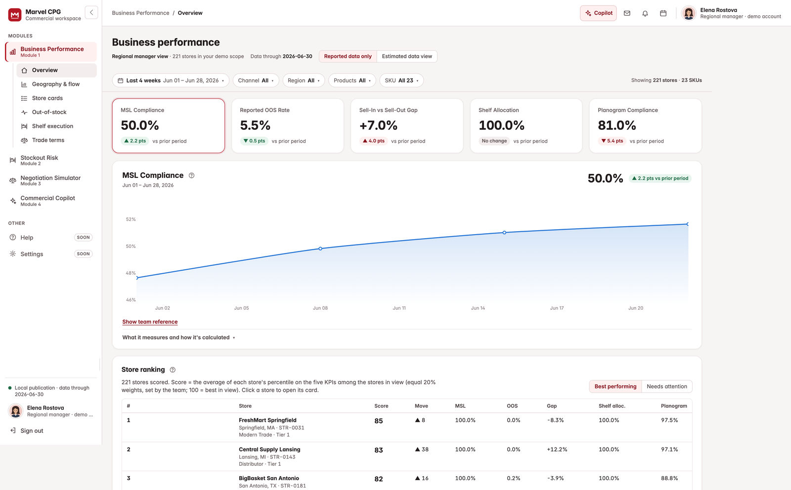
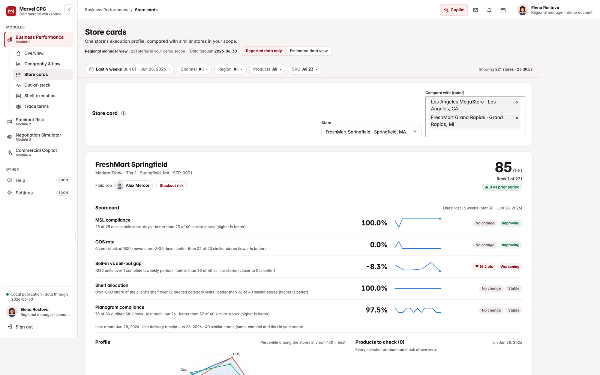
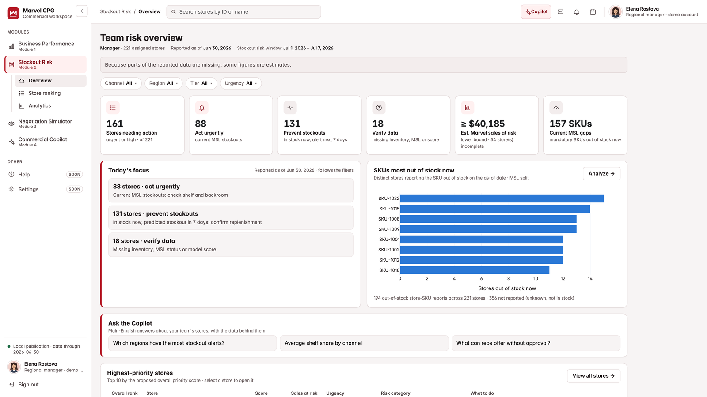
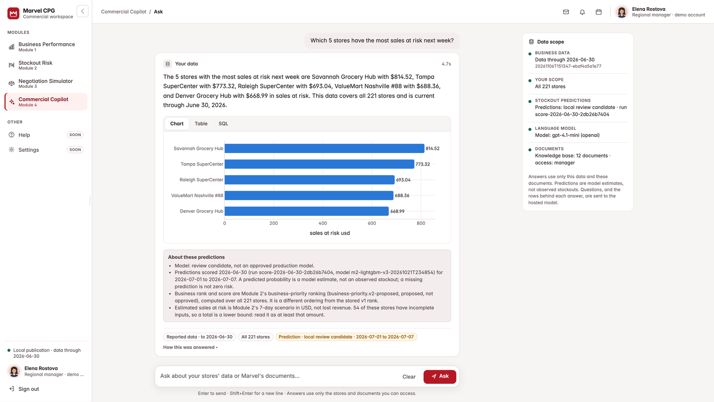
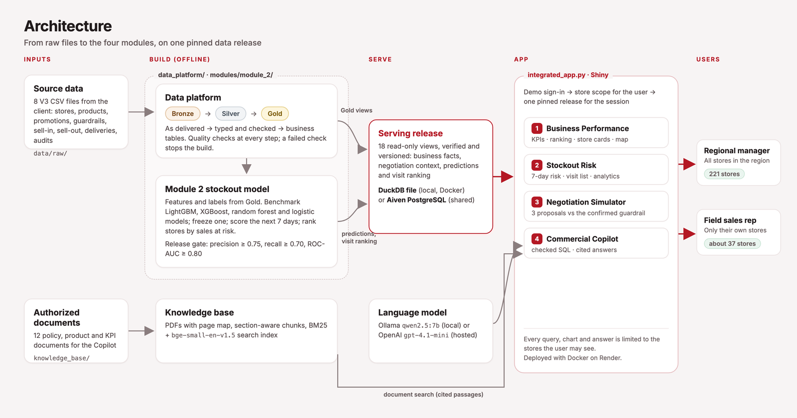
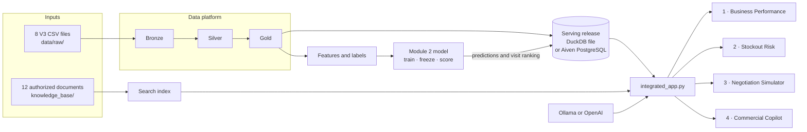

<div align="center">

# Marvel CPG Commercial Workspace

**From KPIs to the next store visit.**<br>
One workspace where regional managers and field sales reps see how their stores perform, which shelves will go
empty next week, whether a deal holds up, and get answers in plain English.


[Overview](#1-product-overview) · [Architecture](#2-architecture) · [Quick start](#3-quick-start) ·
[Reproduce](#4-reproduce-end-to-end) · [Use it](#5-using-the-workspace) · [Configure](#6-configuration) ·
[Deploy](#7-deployment) · [Test](#8-testing) · [Docs](#10-documentation-map)



</div>

---

## 1. Product overview

Marvel CPG sells household cleaning products (Dishwashing, Laundry, Surface Cleaners) to retail stores and
distributors through three channels: Modern Trade, Traditional Trade and Distributor. Its commercial team needs
to know which stores are slipping, where products will run out, and how far a trade discount can go. Today that
information sits in separate files and reports.

The workspace brings it together for two roles:

| Role | Sees | Typical questions |
| --- | --- | --- |
| **Regional manager** | Every store in the region | Which stores need attention? Is this deal acceptable? Where is the risk? |
| **Field sales rep** | Only the stores assigned to them | Which store do I visit first? What can I offer this account? |

### The four modules

<table>
<tr>
<td width="50%" valign="top">

#### 1 · Business Performance

- Five KPIs: MSL compliance, out-of-stock rate, sell-in vs sell-out gap, shelf allocation and planogram
  compliance, each with its definition and formula in the page.
- Store ranking (0–100 score), store cards with 13-week trends and a peer radar, a state map and sell-in vs
  sell-out flow.
- One switch between reported data and the data platform's estimates.

</td>
<td width="50%" valign="top">

#### 2 · Stockout Risk

- Predicts whether a store-SKU will be out of stock on any of the next 7 days.
- Turns the risk into a visit list: which stores to visit first, ranked by sales at risk, with what to do.
- A model is released only if it passes the gate **precision ≥ 0.75, recall ≥ 0.70 and ROC-AUC ≥ 0.80**
  together on held-out data; otherwise the page labels its predictions as a review candidate.

</td>
</tr>
<tr>
<td></td>
<td></td>
</tr>
<tr>
<td width="50%" valign="top">

#### 3 · Negotiation Simulator

- Three proposals side by side for one store and product, checked against the channel × category guardrail
  confirmed by the client:
  - the **standard discount** needs no condition;
  - an **additional discount** up to the maximum needs the required execution commitment;
  - anything above that needs **manager approval**;
  - the gross margin must stay **at or above the minimum** in every case.
- Five verdicts: **Approved**, **Approved with conditions**, **Manager review**, **Rejected**, **Cannot assess**.
- A price-change view: volume, revenue and gross-profit response to a list-price change.

</td>
<td width="50%" valign="top">

#### 4 · Commercial Copilot

- **Data questions** become one checked, read-only SQL query over the user's own stores, with a written
  answer, a chart, the table and the SQL.
- **Policy and product questions** are answered only from 12 authorized documents, with citations to the
  document, version, section and PDF page.
- Runs on a local model through Ollama (nothing leaves the machine) or on OpenAI `gpt-4.1-mini` for the
  deployed site.

</td>
</tr>
<tr>
<td></td>
<td></td>
</tr>
</table>

### Design principles

- **One data release for everything.** All four modules read the same versioned release, so their numbers agree.
- **Role-aware.** Every query, chart and Copilot answer is limited to the stores the signed-in user may see.
- **Unknown is not zero.** Missing data is shown as unknown; estimates are separate, opt-in and labelled.
- **Answers you can check.** Every number has its definition, every Copilot answer its SQL or its citations.

The data is synthetic demo data provided for this project. Screenshots show it.

---

## 2. Architecture



<details>
<summary><b>Text version of the diagram</b></summary>



</details>

1. The **data platform** turns the raw CSV files into Bronze (as delivered), Silver (typed and checked) and Gold
   (business tables), with quality checks at every step.
2. **Module 2** trains its models offline on the platform's features, freezes the chosen model and scores the
   latest day. Its predictions and visit ranking are added to the release.
3. The **serving release** holds 18 read-only views: a DuckDB file locally, or a PostgreSQL database on Aiven
   when shared.
4. The **app** pins one release per session and serves the four modules. The Copilot also uses the search
   index over the authorized documents and a language model.

| Folder | Role | Details |
| --- | --- | --- |
| `data_platform/` | Ingestion, Bronze/Silver/Gold, features, labels, serving release, PostgreSQL publishing | [data_platform README](data_platform/README.md) |
| `modules/module_1/` | Business Performance | [Integrated app guide](docs/integrated-app.md#business-performance-module-1) |
| `modules/module_2/` | Stockout model: training, release gate, scoring, ranking, monitoring, pages | [Module 2 README](modules/module_2/README.md) |
| `modules/module_3/` | Negotiation Simulator | [Integrated app guide](docs/integrated-app.md#negotiation-simulator-module-3) |
| `modules/module_4/` | Copilot: question routing, Text-to-SQL sandbox, cited answers | [Module 4 README](modules/module_4/README.md) |
| `knowledge_base/` | The 12 documents, their PDFs, the search index and its evaluation | [Knowledge base README](knowledge_base/README.md) |
| `shared/` | App shell, sign-in, data runtime, shared design | [Integrated app guide](docs/integrated-app.md) |

**Key concepts**

- **Release.** A versioned, verified snapshot of all serving views. A running app pins one release; restart it to
  pick up a new one.
- **Scope.** Each identity sees a fixed set of stores. The demo identities use a demo assignment: the manager
  sees all stores, each rep a round-robin share.
- **Reported vs estimated.** Reported values come from the source files. Estimates fill short reporting gaps
  and live in separate views that a page must ask for explicitly.

**Tech stack:** Python 3.13 · Shiny for Python · DuckDB · PostgreSQL · pandas · LightGBM, XGBoost and
scikit-learn · Plotly · BM25 and `bge-small-en-v1.5` embeddings · Ollama or OpenAI · Docker.

---

## 3. Quick start

Run the workspace in a few minutes on generated synthetic data. No data files or API keys are needed.

**Requirements:** Python 3.13 and [uv](https://docs.astral.sh/uv/) on macOS, Linux or WSL2. Dependency versions
are locked in `uv.lock`.

```bash
git clone https://github.com/Zeye430/marvel-cpg-ai-platform.git
cd marvel-cpg-ai-platform
uv sync --frozen --extra app --extra module4 --extra postgres

uv run --extra app --extra module4 --extra postgres \
  python tests/browser/run_integrated_acceptance.py --serve --port 8000
```

Open <http://127.0.0.1:8000> and pick a demo identity:

| Identity | Role | Sees |
| --- | --- | --- |
| Elena Rostova | Regional manager | All stores in the demo scope |
| Alex Mercer | Field sales rep | Only Alex's stores |
| Beatrice Vance | Field sales rep | Only Beatrice's stores |

**Expected:** the sign-in page, then Business Performance for the synthetic stores (names start with
`SYNTHETIC`). The Copilot uses a placeholder model in this mode; section 4.5 connects a real one.
Sign-in is for demos only.

---

## 4. Reproduce end to end

This section rebuilds everything the deployed site shows from the original data: the data release, the
Module 2 predictions and the knowledge base. Run every command from the repository root.

```bash
uv sync --frozen --extra app --extra module2 --extra module4 --extra postgres
```

### 4.1 Inputs

The project data is not stored in Git. **Request the following from the project team** and keep them outside
version control:

1. **The 8 V3 source files**, placed directly in `data/raw/` (ignored by Git):

   ```text
   dim_stores.csv        dim_products.csv        dim_promotions.csv      dim_guardrails.csv
   fact_sell_in.csv      fact_sell_out.csv       fact_deliveries.csv     fact_execution_audits.csv
   ```

   Their columns are fixed by the source contract
   [`data_platform/contracts/v3/sources.json`](data_platform/contracts/v3/sources.json) (version
   `v3.sources.3`, with the client-confirmed guardrail rules). A file that does not match is rejected.
2. **The frozen Module 2 model run** (the folder `v3-20261021-r1`), for section 4.3.

### 4.2 Build the data release

```bash
uv run --extra module2 --extra postgres python -m data_platform build-all \
  --as-of 2026-06-30 --rolling-evaluation --assume-complete-snapshot \
  --output-root outputs/v3/platform/delivery
```

This takes a few minutes and writes to `outputs/v3/platform/delivery/`:

```text
runs/<run-id>/run.json                         the workflow record: status and the path of every component
base/builds/<id>/build.duckdb                  Bronze, Silver and Gold
features/builds/<id>/features.duckdb           development features (through May 31)
evaluation/labels/builds/<id>/labels.duckdb    development labels
scoring/features/builds/<id>/features.duckdb   scoring features (through June 30)
serving/builds/<id>/                           the release without model outputs
```

**Expected:** `runs/<run-id>/run.json` shows `"status": "Accepted"`, and so do all five components (base,
features, labels, scoring features, serving). Note the `<run-id>` for the next step.

### 4.3 Add the Module 2 predictions

Score the latest day with the frozen model. This never trains: the model, its benchmark and its release-gate
evidence come unchanged from the frozen run.

```bash
# A new run folder with the frozen parts only (no earlier scores or releases)
mkdir -p outputs/v3/module2/delivery/my-run
cp -Rp <frozen run>/{benchmark,bundle,config.json,evaluation,final-report.json,governance,holdout,logs} \
  outputs/v3/module2/delivery/my-run/

uv run --extra module2 --extra postgres python -m modules.module_2 daily \
  --run-dir outputs/v3/module2/delivery/my-run \
  --workflow-run outputs/v3/platform/delivery/runs/<run-id>/run.json
```

**Expected:** the command prints `"step": "daily_done"` with the model's bundle hash, and writes the
application release to `outputs/v3/module2/delivery/my-run/serving/builds/<id>/` (`business.duckdb`,
`quality.json`, `run.json`). This folder is what the app and the deployment use.

<details>
<summary><b>Retrain the models instead</b></summary>

`python -m modules.module_2 deliver --profile v3` benchmarks the candidate models, freezes one, validates it and
checks it on held-out data. It takes much longer and needs an owner execution policy file. See
[Module 2 README, sections 4 and 6](modules/module_2/README.md#4-run).

</details>

### 4.4 Rebuild the knowledge base

The repository already contains the built PDFs and search index. Rebuild them only after changing a document:

```bash
uv run --extra module4 --with "fpdf2>=2.8,<3.0" python knowledge_base/tools/build_kb.py
uv run --extra module4 python knowledge_base/tools/evaluate.py --report knowledge_base/eval/retrieval_results_hybrid.md
```

**Expected:** `12 documents, 177 chunks`; the evaluation passes 35 of 35 questions. The figures quoted in the
documents come from `knowledge_base/tools/compute_data_facts.py --data-dir data/raw`.

### 4.5 Run the app on the release

Choose the Copilot's language model:

- **Local:** install [Ollama](https://ollama.com), then `ollama pull qwen2.5:7b` and `ollama serve`.
- **Hosted:** put `MODULE4_LLM_PROVIDER=openai`, `MODULE4_LLM_MODEL=gpt-4.1-mini` and `MODULE4_LLM_API_KEY` in a
  private file outside the repository (for example `~/.config/marvel/openai.env`) and load it into the shell.
  Questions and the rows behind each answer are then sent to OpenAI.

```bash
set -a; source ~/.config/marvel/openai.env; set +a      # only for the hosted model
SHARED_DATA_ARTIFACT_DIR=outputs/v3/module2/delivery/my-run/serving/builds/<id> \
  uv run --extra app --extra module4 shiny run integrated_app.py --port 8000
```

### 4.6 Publish to Aiven PostgreSQL (optional)

The deployed site reads the release from a PostgreSQL database on Aiven. Publishing copies it there once. Keep
the publisher account (`SHARED_DATA_PUBLISH_DATABASE_URL`), the read-only application account
(`SHARED_DATA_DATABASE_URL`) and the CA file path (`SHARED_DATA_SSLROOTCERT`) in a private file, and load it
first. Connection URLs must end with `?sslmode=verify-full`.

```bash
R=outputs/v3/module2/delivery/my-run/serving/builds/<id>
uv run --extra postgres python -m data_platform.postgres_cli inspect-source --artifact-dir "$R"   # local check
uv run --extra postgres python -m data_platform.postgres_cli preflight                          # read-only
uv run --extra postgres python -m data_platform.postgres_cli load --artifact-dir "$R"             # dry run
uv run --extra postgres python -m data_platform.postgres_cli load --artifact-dir "$R" --apply --confirm-database <db>
uv run --extra postgres python -m data_platform.postgres_cli activate --release-id <release id> --apply --confirm-database <db>
```

- On a new database, run `init --apply --confirm-database <db>` once, and give the demo identities their stores
  with `configure-scopes --policy-file outputs/v3/module2/delivery/my-run/governance/demo-scope.json --apply
  --confirm-database <db>`.
- Each release takes about 3.5 GB, and at most three can be stored. Loading and activating verify the whole
  release and take several minutes each.
- Restart the app after activation: it pins the release it started with.

Details: [Shared PostgreSQL publication](data_platform/README.md#shared-postgresql-publication-opt-in).

### 4.7 Check the result

| Check | Expected |
| --- | --- |
| Data date in the sidebar | `data through 2026-06-30` |
| Stores for Elena Rostova (manager) | 221 |
| Stores for Alex Mercer / Beatrice Vance | 37 each |
| Stockout Risk | 4,375 store-SKU predictions for Jul 1–7, 2026; 221 stores in the visit list |
| Negotiation Simulator | "Rules confirmed by the client"; a Distributor proposal within the maximum with a commitment is **Approved with conditions** |
| Unit tests (section 8) | All pass |

To inspect a release without the app:

```bash
uv run python -m examples.read_shared_data --artifact-dir outputs/v3/module2/delivery/my-run/serving/builds/<id> --schema-only
```

---

## 5. Using the workspace

### Regional manager

1. **Business Performance → Overview.** Check the five KPIs against the previous period, then the store ranking:
   switch between *Best performing* and *Needs attention*.
2. **Store cards.** Open a weak store: its scorecard, 13-week trends, peers on the radar and its field rep.
3. **Geography & flow.** Find regions where sell-in runs ahead of sell-out (stock building up) or behind it.
4. **Stockout Risk.** See how many stores need action and the total sales at risk, then the team's visit list.
5. **Negotiation Simulator.** Check a proposal that needs your approval: margin, commitment and evidence.

### Field sales rep

1. **Stockout Risk.** Start the day with *Highest-priority stores*: who to visit first and what to check.
2. **Store cards.** Before the visit, look at the store's KPIs and recent trend.
3. **Negotiation Simulator.** Before negotiating, compare three offers for the store and product: the standard
   discount, an additional discount with a commitment, and a larger one that needs approval.
4. **Commercial Copilot.** Ask about the store's data or about policy while preparing.

### Copilot examples

| Data questions | Policy and product questions |
| --- | --- |
| Which 5 stores have the most sales at risk next week? | What can reps offer without approval? |
| Average shelf share by channel | What commitment do I need for an additional discount in Traditional Trade Laundry? |
| Which regions have the most stockout alerts? | Which SKU can I substitute for Power Clean Lemon 1L? |

---

## 6. Configuration

All settings are environment variables. Keep passwords and keys in a private file outside the repository or in
the host's secret settings, never in Git.

| Variable | Meaning |
| --- | --- |
| `SHARED_DATA_ARTIFACT_DIR` | A local release folder (`business.duckdb`, `quality.json`, `run.json`) |
| `SHARED_DATA_PUBLICATION` | Alternative: a local published `serving.json` pointer |
| `SHARED_DATA_BACKEND` | `postgres` to read the shared PostgreSQL release instead of a local file |
| `SHARED_DATA_DATABASE_URL` | Read-only application account on PostgreSQL, ending in `?sslmode=verify-full` |
| `SHARED_DATA_SSLROOTCERT` | Path of the CA file for verified TLS |
| `SHARED_DATA_RELEASE_ID` | Optional: pin an earlier published release |
| `SHARED_DATA_PUBLISH_DATABASE_URL` | Publisher account, for `postgres_cli` only; never give it to the app |
| `MODULE4_LLM_PROVIDER` | `ollama` (default) or `openai` |
| `MODULE4_LLM_MODEL` | For example `qwen2.5:7b` or `gpt-4.1-mini` |
| `MODULE4_LLM_API_KEY` | OpenAI API key (hosted model only) |
| `MODULE4_LLM_BASE_URL` | Ollama address, if not the default |
| `MODULE4_RAG_DENSE` | `0` for keyword-only document search (no embedding package) |

More settings: [integrated app guide](docs/integrated-app.md#settings).

---

## 7. Deployment

### Docker

The image starts `integrated_app.py` and holds no business data, so give it a release:

```bash
docker build -t marvel-cpg-dashboard .
docker run --rm -p 127.0.0.1:8000:8000 -v <release folder>:/data:ro \
  -e SHARED_DATA_ARTIFACT_DIR=/data --env-file <private env file> marvel-cpg-dashboard
```

The container runs as user 1000, which must be able to read the release folder. `docker compose up --build` uses
the same image. See [Run it in Docker](docs/integrated-app.md#run-it-in-docker).

### Render with Aiven

Create a **Web Service** from this repository (environment **Docker**, branch `main`). Choose an instance with at
least 2 GB of memory (Standard): three people using the site at once peak at about 800 MB, and 512 MB is not
enough. Then set:

| Variable | Value |
| --- | --- |
| `SHARED_DATA_BACKEND` | `postgres` |
| `SHARED_DATA_DATABASE_URL` | Read-only application account on the Aiven release |
| `SHARED_DATA_SSLROOTCERT` | `/etc/secrets/aiven-ca.pem`, with the Aiven CA certificate added as a Secret File of that name |
| `MODULE4_LLM_PROVIDER` | `openai` |
| `MODULE4_LLM_MODEL` | `gpt-4.1-mini` |
| `MODULE4_LLM_API_KEY` | OpenAI API key, as a secret value |

`PORT` is set by Render. Choose the Render region closest to the Aiven service, and restart the service after
activating a new release (section 4.6). Sign-in is demo-only, so do not expose a site holding real client data
publicly.

---

## 8. Testing

```bash
# Unit and integration tests
uv run --extra module2 --extra postgres --extra app --extra module4 python -m unittest discover -s tests

# Knowledge base
uv run --extra module4 python -m unittest discover -s knowledge_base/tests

# Browser acceptance (synthetic data, placeholder model; needs Node and Google Chrome)
uv run --extra app --extra module4 --extra postgres \
  python tests/browser/run_integrated_acceptance.py --out <evidence folder>
```

**Expected:** all unit tests pass (a few PostgreSQL tests are skipped without a local server); the knowledge-base
tests pass; the browser suite reports 0 failed checks and writes screenshots to the evidence folder.

---

## 9. Repository layout

<details>
<summary><b>Show the folders</b></summary>

```text
integrated_app.py     The app: all four modules on one shared data release
shared/               Shell, sign-in, data runtime and the shared design (ui_kit)
modules/module_1/     Business Performance
modules/module_2/     Stockout Risk: modelling, scoring, ranking, monitoring and pages
modules/module_3/     Negotiation Simulator
modules/module_4/     Commercial Copilot: routing, Text-to-SQL sandbox, cited answers
knowledge_base/       The Copilot's 12 authorized documents, PDFs, index and evaluation
data_platform/        Data build, validation, serving release and PostgreSQL publishing
examples/             Small scripts that read a release
docs/                 Guides, data dictionary, specifications and images
notebooks/            V3 data analysis and model development
tests/                Unit tests and the browser acceptance suite
app.py, www/          Earlier root app, kept for reference only (not deployed)
```

</details>

---

## 10. Documentation map

| If you want to… | Read |
| --- | --- |
| Understand the shared data and connect a module | [Shared-data guide](docs/data/README.md) |
| Look up a field | [Gold data dictionary](docs/data/v3-gold-data-dictionary.md) |
| Run data-platform commands | [data_platform README](data_platform/README.md) |
| Know what each page shows and its limits | [Integrated app guide](docs/integrated-app.md) |
| Train, score or monitor the stockout model | [Module 2 README](modules/module_2/README.md) |
| Change the Copilot or its evaluation | [Module 4 README](modules/module_4/README.md) |
| Edit the Copilot's documents | [Knowledge base README](knowledge_base/README.md) |
| See how the KPIs and missing days are defined | [KPI specification](docs/solution-specifications/kpi-and-missing-store-day-handling.md) |

---

## 11. Status and limitations

- The data is synthetic demo data for this project; store-to-rep assignments are demo assignments.
- Module 2's predictions come from a review-candidate model until one passes the release gate; the page labels
  them.
- Module 3's guardrail rules are confirmed by the client. Only the volume-uplift assumption can be switched, and
  nothing is approved, sent or saved automatically.
- Sign-in is for demos only: it is not production authentication.

---

## 12. Contributing and license

**Contributing (project team):** keep `main` stable and work on a branch for each task; open a pull request and
ask at least one teammate to review it; never commit API keys, passwords, `.env` files or project data.

**License: proprietary, all rights reserved.** This repository is not open source. No license is granted to use,
copy, modify, distribute or deploy any part of it, including the code, documents, data and images, without
written permission from the project owners. Viewing the code on GitHub does not grant any of these rights.
