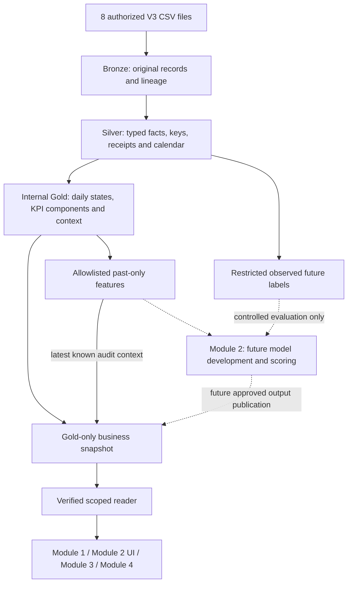

# Shared V3 data platform — start here

Read this page, then **only your module's guide**. The dictionary is a lookup,
not required first reading. The shared layer serves all four modules; it does
not replace their application/model development.

| Your task | Read next | Shared input |
| --- | --- | --- |
| Module 1: KPIs / Store 360 | [Module 1 guide](v3-module-1-integration.md) | Reported daily facts, KPI components, commercial periods and execution visits |
| Module 2: OOS / visits | [Module 2 guide](v3-module-2-integration.md), [module README](../../modules/module_2/README.md) | Private features/labels and time folds; latest scoring inputs; published predictions/ranking and manager-only model health |
| Module 3: negotiation | [Module 3 guide](v3-module-3-integration.md) | Negotiation context, reference economics and review-required guardrails |
| Module 4: data/knowledge assistant | [Module 4 guide](v3-module-4-integration.md) | Scoped business views and metric definitions; document retrieval is a separate module responsibility |
| Check a field/type/grain | [Gold dictionary](v3-gold-data-dictionary.md) | 16 named serving views, including three opt-in Estimated candidate views |

## 1. Architecture and release boundaries



| File | Consumer / boundary |
| --- | --- |
| `build.duckdb` | Internal Bronze/Silver/Gold; never an app or model-input connection |
| `features.duckdb` | Authorized Module 2 analytical jobs; point-in-time predictors |
| `labels.duckdb` | Authorized model training/evaluation; never predictors, scoring or UI |
| `business.duckdb` | All four module applications through the scoped reader |

DuckDB is an embedded file database: no database host/port, Docker or PostgreSQL
server is needed for this local workflow. Files must be provisioned inside the
trusted runtime; this is not a cross-machine SQL service or an authentication system.

Business and latest-scoring data reach **2026-06-30**. Separately, development
features/labels stop **May 31**: March/April development, May validation,
**June independent test**. `build-all` never opens June test truth. That requires
frozen-model and passed-May evidence described in the Module 2 guide. June 30
scoring predicts July 1–7 without future labels.

Reported facts are the business default. Missing reports mean **Unknown**, not
zero sales/stock. Separate `estimated_*` views contain candidate reconstructions:
opt in explicitly and display Observed/Estimated/Unknown, coverage and Candidate
status. Their availability is not operational approval. Guardrails remain
**Requires review**. Model predictions/ranking are empty typed interfaces;
unavailable is not 0% risk. No module independently rewrites these shared rules.

This branch delivers the data foundation, not a trained model, module UI,
scenario store, NLQ/RAG engine, scheduled ingestion, Airflow or AWS deployment.
Existing legacy Module 1/Aiven ETL is not automatically migrated.

## 2. Set up and verify inputs

From the repository root, use Python **3.13** and `uv` on macOS/Linux or WSL2
(Unix file locking; native Windows is unverified):

```bash
uv sync --frozen
```

Request the authorized V3 files privately and place them directly in ignored
`data/raw/`. Git checkout does not supply these files or generated databases.

```text
dim_stores.csv             fact_sell_in.csv
dim_products.csv           fact_sell_out.csv
dim_promotions.csv         fact_deliveries.csv
dim_guardrails.csv         fact_execution_audits.csv
```

Use four corrected facts and four retained approved dimensions. Do not substitute
legacy `new_marvel_data/` facts or unapproved ZIP dimensions/guardrails.

```bash
uv run python -m data_platform audit-data \
  --output-path outputs/v3/platform/onboarding/source-audit.json
```

Read the JSON: require `active_matches_authorized_v3: true`, all eight matching
ordered headers and this `active_dataset_hash`:

```text
f5403651d8aa3e9492071a14706dd7a7f31aec88247f7af2f083ab9dca782675
```

The diagnostic can exit 0 on mismatch: **exit status alone is insufficient**.
Stop and obtain the approved inputs if mismatched; a later dataset needs contract
review, not edited CSV values. Git-ref comparisons use locally fetched refs.

## 3. Build and publish a local snapshot

```bash
uv run python -m data_platform build-all \
  --as-of 2026-06-30 \
  --output-root outputs/v3/platform/delivery \
  --assume-complete-snapshot --memory-limit 1GB --threads 2 --publish
```

Require workflow `status: Accepted`. The completeness flag asserts a complete
order/receipt snapshot, permitting zero empty event counts; omit it if unconfirmed
and those counts remain unknown. It does not approve estimates or invoice
completeness. Omit `--publish` to build without switching the serving pointer.
Do not run this data job during a page/chat request or run competing writers.

```text
outputs/v3/platform/delivery/
  runs/<id>/run.json                         workflow status and component paths
  base/builds/<id>/build.duckdb               INTERNAL source/business construction
  features/builds/<id>/features.duckdb        DEVELOPMENT through May 31
  evaluation/labels/builds/<id>/labels.duckdb  RESTRICTED development outcomes
  scoring/features/builds/<id>/features.duckdb SCORING through June 30
  serving/builds/<id>/business.duckdb          application snapshot
  serving/published/serving.json               accepted snapshot pointer
  serving/published/history/<id>.json          publication / rollback history
```

Snapshots are immutable and integrity checked. Use the accepted manifest, not
the newest directory (which may be failed/unpublished). Failed builds do not
replace the published version. Individual commands/rollback are listed in the
[package reference](../../data_platform/README.md).

## 4. Read schema, then enable approved account scope

```bash
uv run python -m examples.read_shared_data --schema-only
```

Expect the June 30 cutoff and 16 view schemas. By default there are **no account
assignments**: business-row reads deny access. In your editor, create ignored
`work/access-policy.local.json` using a real approved store ID:

```json
{
  "version": "approved-local-v1",
  "assignments": [
    {"principal_id": "team-local-dev", "store_id": "REPLACE_WITH_APPROVED_STORE_ID", "role": "sales"}
  ]
}
```

Re-run the build with `--access-policy work/access-policy.local.json`, or rebuild
only serving using accepted component directories from the workflow manifest:

```bash
uv run python -m data_platform build-serving \
  --source-build-dir /YOUR/accepted/base/build-directory \
  --feature-build-dir /YOUR/accepted/scoring/features/build-directory \
  --access-policy work/access-policy.local.json \
  --output-root outputs/v3/platform/delivery/serving --publish
uv run python -m examples.read_shared_data \
  --principal-id team-local-dev --view store_day \
  --start 2026-06-01 --end 2026-06-30 --limit 10
```

Use the **June SCORING**, not May DEVELOPMENT, feature artifact; source identity
and cutoff must match. CLI identity is trusted local testing only. Applications
must derive identity from the verified session, never a URL, prompt or LLM.

## 5. Connect your module

```python
from examples.read_shared_data import open_reader

reader = open_reader()  # Verify and pin one accepted snapshot per request/job.
snapshot_date = reader.record["as_of"]
# Supplied by your application's authenticated session, not caller input:
# rows = reader.read("store_day", verified_principal_id,
#                    start=snapshot_date, end=snapshot_date, limit=1000)
```

The [runnable adapter](../../examples/read_shared_data.py) is an example, not a
deployed API. `ServingReader` supports named views, scoped stores and 1–10,000
rows; no arbitrary SQL, pagination or general aggregate API. A limited sample
is not a company KPI. Use shared numerator/denominator components and reviewed
aggregate interfaces. Keep files private; read-only DuckDB is not a SQL sandbox.

For candidate estimates use, for example, `--view estimated_store_day
--allow-candidate-estimates` on the CLI, or `allow_candidate_estimates=True` in
the reader's `read(...)` call. Preserve candidate/per-value status in the UI.

If privately sharing an accepted serving artifact, copy `business.duckdb`,
`run.json` and `quality.json` from the **same accepted directory**; use
`--artifact-dir /local/copied-directory`. Existing scope still applies. Do not
edit manifests or reuse another machine's absolute publication paths. This
serving-only copy cannot rebuild internal features/labels.

## 6. Troubleshooting and shared rules

| Problem | Action |
| --- | --- |
| Source hash/header mismatch | Obtain the approved V3 set; stop before building |
| No `serving.json` | Build with `--publish`, select a local `--publication`, or use an accepted `--artifact-dir` |
| Artifact integrity failure | Restore/rebuild the complete artifact; never bypass checks |
| No configured account scope | Obtain approved assignments and build a new serving snapshot |
| Prediction/ranking unavailable | Expected in base serving and when no qualified model output is published; never replace with 0% risk |
| Unknown metric / Requires review | Preserve the state; do not invent business approval |
| Wrong cutoff | Separate June business/scoring from May development artifacts |

Run `uv run python -m unittest discover -s tests -v` and `git diff --check` before
proposing changes. Source acceptance and synthetic tests do not certify model
targets or estimator accuracy. Reader exits 3 for unavailable/candidate-without-
opt-in, 1 for read/permission/integrity failure and 2 for invalid arguments.

Detailed rules: [KPI/missing-day specification](../solution-specifications/kpi-and-missing-store-day-handling.md),
[source schemas](../../data_platform/contracts/v3/sources.json),
[module interfaces](../../data_platform/contracts/v3/module-data-contract.json).
Historical build/review records are not required for module integration. Raw
files, databases, generated evidence, real scopes and local notes stay outside Git.
Develop each module on its own branch from the reviewed shared-layer version.
