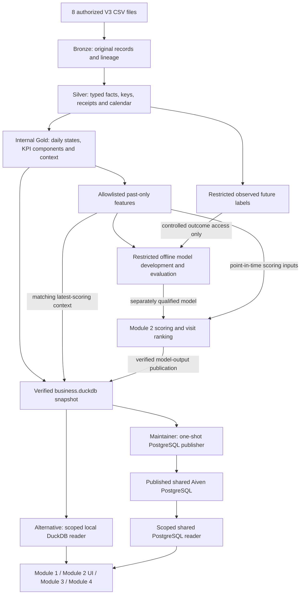

# Shared V3 data platform — start here

Read this page, then **only your module's guide**. The dictionary is a lookup,
not required first reading. The shared layer serves all four modules; it does
not replace their application/model development.

## Module developers: connect to the published Aiven data

The shared V3 business tables are **already published to Aiven PostgreSQL**.
Start with the [Aiven connection tutorial](../aiven-connection.md): obtain the
private read-only connection pack, configure TLS, inspect the schema and make a
small scoped read. Then read only your module's guide below.

You do not need your own Aiven account, raw CSVs, a local database, another ETL
pipeline or another upload to consume this release. Each module developer owns
its data reads, field mapping and UI/business integration. A database publication
does not automatically migrate existing module code.

Current release: `r439c038733973c0547655802`, business date **2026-06-30**,
18 serving views. Model outputs retain their local-review candidate status;
estimated views remain opt-in candidates. This is a shared data-service delivery,
not acceptance of the integrated application or production authentication.

Local DuckDB remains an alternative for maintainers/offline work; sections 2–4
below explain that path. Module developers connecting to Aiven can skip those
raw-data/build steps.

For the exact scripts, functions and responsibilities, see the
[code map and reuse boundaries](../../data_platform/README.md#code-map-which-script-does-what).
For commands, see the [package reference](../../data_platform/README.md#commands).
An `ETL/` wrapper may call these existing entry points, but should not maintain
a second copy of the shared transformations. A raw-table loader or independent
set of similarly named Gold tables is not a verified shared serving release.

Choose your workflow:

- **Data maintainers** provision V3 inputs, run DuckDB processing and validate
  business releases. The local build instructions below are for this role.
- **Module developers** consume an agreed serving release through the shared
  reader; they do not each rebuild raw data or implement their own ETL.
- **Offline ML developers** use separately authorized features/labels and evaluation
  gates. An application database connection does not authorize training or test access.

| Your task | Read next | Shared input |
| --- | --- | --- |
| Module 1: KPIs / Store 360 | [Module 1 guide](v3-module-1-integration.md) | Reported daily facts, KPI components, commercial periods and execution visits |
| Module 2: OOS / visits | [Module 2 guide](v3-module-2-integration.md), [module README](../../modules/module_2/README.md) | Private features/labels and time folds; latest scoring inputs; published predictions/ranking and manager-only model health |
| Module 3: negotiation | [Module 3 guide](v3-module-3-integration.md) | Negotiation context, reference economics and review-required guardrails |
| Module 4: data/knowledge assistant | [Module 4 guide](v3-module-4-integration.md) | Scoped business views and metric definitions; document retrieval is a separate module responsibility |
| Check a field/type/grain | [Gold dictionary](v3-gold-data-dictionary.md) | 18 named serving views are defined, including three opt-in Estimated candidate views; inspect the selected release for availability |

## 1. Architecture and release boundaries



The shared PostgreSQL path is published and has been checked on the actual
Aiven service: verify-full TLS, a read-only application role, 18 views and scoped
reads. It uses the existing publisher/reader; no second transformation pipeline
is needed. Local DuckDB remains available as a separate reading path.

This diagram describes data delivery, not proof that every module UI has been
migrated. Each module developer wires the shared reader into its own backend.
Only the selected package's model outputs/statuses are published; copying a
database does not qualify a model or approve an estimator. The legacy
Module 1/Aiven raw-table loader is a different interface and cannot be switched
to the shared serving release just by replacing its URL.

| File | Consumer / boundary |
| --- | --- |
| `build.duckdb` | Internal Bronze/Silver/Gold; never an app or model-input connection |
| `features.duckdb` | Authorized Module 2 analytical jobs; point-in-time predictors |
| `labels.duckdb` | Authorized model training/evaluation; never predictors, scoring or UI |
| `business.duckdb` | Shared business input for all four modules through the scoped reader; actual module migration is separate |

DuckDB is an embedded file database: no database host/port, Docker or PostgreSQL
server is needed for this local workflow. Files must be provisioned inside the
trusted runtime; this is not a cross-machine SQL service or an authentication system.

This project uses a fixed dataset through **2026-06-30**, treated as business
"today". No future feed, daily scheduler or automatic cloud pipeline is required.
June 30 scoring predicts **July 1–7**; those future outcomes are not supplied.

For new Module 2 work, use the shared **strict rolling-30-day** plan, not permanent
calendar-month splits. For this snapshot, test reserves June 1–30, validation
reserves May 2–31 and training uses earlier eligible history. Seven-day targets
require purging and mature, complete observed outcomes: the latest eligible
validation/test scoring dates are May 24/June 23. Development artifacts stop at
May 31 while business/scoring data reaches June 30. Legacy fixed-date mode remains
for reproducibility, not as the default policy for new model development.

`build-all` does not unlock test truth; controlled model/evidence/exposure gates
remain separate. The existing evaluated June run is a **disclosed holdout
confirmation**, not an untouched independent test. See the
[Module 2 guide](v3-module-2-integration.md) and
[Module 2 operating instructions](../../modules/module_2/README.md).

Reported facts are the business default. Missing reports mean **Unknown**, not
zero sales/stock. Separate `estimated_*` views contain candidate reconstructions:
opt in explicitly and display Observed/Estimated/Unknown, coverage and Candidate
status. Their availability is not operational approval. Guardrails remain
**Requires review**. A base data-only snapshot has empty/unreleased prediction
and ranking tables; a separately verified model-output snapshot can contain
predictions, priorities and aggregate health/monitoring. Check its release status,
model version and scoring date: unavailable is not 0% risk. No module independently
rewrites these shared rules.

Module 2 model comparison, training/evaluation, scoring/ranking and a standalone
dashboard are implemented. Candidate/synthetic status and the complete root-app
integration limits remain explicit; this is not production release certification.
The shared layer supplies business data; module developers own their application
interfaces, simulator, NLQ/RAG and UI behavior. Shared business tables are
published to Aiven; completed end-to-end app integration/deployment is separate.
No future data feed or daily automation is delivered by this publication.

## 2. Set up and verify inputs — data maintainers

From the repository root, use Python **3.13** and `uv` on macOS/Linux or WSL2
(Unix file locking; native Windows is unverified):

```bash
uv sync --frozen
```

Request the authorized V3 files privately and place them directly in ignored
`data/raw/`. Git checkout does not supply these files or generated databases.

```text
dim_stores.csv             fact_sell_in.csv
dim_products.csv           fact_sell_out.csv
dim_promotions.csv         fact_deliveries.csv
dim_guardrails.csv         fact_execution_audits.csv
```

Use four corrected facts and four retained approved dimensions. Do not substitute
legacy `new_marvel_data/` facts or unapproved ZIP dimensions/guardrails.

```bash
uv run python -m data_platform audit-data \
  --output-path outputs/v3/platform/onboarding/source-audit.json
```

Read the JSON: require `active_matches_authorized_v3: true`, all eight matching
ordered headers and this `active_dataset_hash`:

```text
f5403651d8aa3e9492071a14706dd7a7f31aec88247f7af2f083ab9dca782675
```

The diagnostic can exit 0 on mismatch: **exit status alone is insufficient**.
Stop and obtain the approved inputs if mismatched; a later dataset needs contract
review, not edited CSV values. Git-ref comparisons use locally fetched refs.

## 3. Build a local data candidate — data maintainers

This builds data artifacts, not a trained model or a model-output publication.
The example selects rolling mode explicitly and does not change the current
serving pointer. Do not rebuild an existing accepted release just to read it.

```bash
uv run python -m data_platform build-all \
  --as-of 2026-06-30 --rolling-evaluation \
  --output-root outputs/v3/platform/delivery \
  --assume-complete-snapshot --memory-limit 1GB --threads 2
```

Require workflow `status: Accepted`. The completeness flag asserts a complete
order/receipt snapshot, permitting zero empty event counts; omit it if unconfirmed
and those counts remain unknown. It does not approve estimates or invoice
completeness. Add `--publish` only when deliberately promoting this data-only
snapshot. Do not replace a selected Module 2 output release with a base snapshot
and expect its predictions to be retained. Do not run this data job during a
page/chat request or run competing writers.

```text
outputs/v3/platform/delivery/
  runs/<id>/run.json                         workflow status and component paths
  base/builds/<id>/build.duckdb               INTERNAL source/business construction
  features/builds/<id>/features.duckdb        DEVELOPMENT through May 31
  evaluation/labels/builds/<id>/labels.duckdb  RESTRICTED development outcomes
  scoring/features/builds/<id>/features.duckdb SCORING through June 30
  serving/builds/<id>/business.duckdb          application snapshot
  serving/published/serving.json               pointer, only after publication
  serving/published/history/<id>.json          publication / rollback history
```

Snapshots are immutable and integrity checked. Use the accepted manifest, not
the newest directory (which may be failed/unpublished). Failed builds do not
replace the published version. Individual commands/rollback are listed in the
[package reference](../../data_platform/README.md).

## 4. Inspect a local release and enable account scope

Select the maintainer-provided publication or accepted artifact directory. For an
unpublished/copied candidate, pass `--artifact-dir /YOUR/accepted/serving/directory`
to the example commands instead of assuming a current publication exists.

```bash
uv run python -m examples.read_shared_data --schema-only
```

Expect the June 30 cutoff; the current code defines 18 views, but availability
depends on the artifact version. Unconfigured builds have **no account
assignments**: business-row reads deny access. For local setup, the maintainer
creates ignored `work/access-policy.local.json` using a real approved store ID:

```json
{
  "version": "approved-local-v1",
  "assignments": [
    {"principal_id": "team-local-dev", "store_id": "REPLACE_WITH_APPROVED_STORE_ID", "role": "sales"}
  ]
}
```

Rebuild only the local base serving snapshot using accepted component directories
from the workflow manifest (or pass the policy to an explicitly requested full
build). Do not overwrite a model-output candidate or copy someone else's scope:

```bash
uv run python -m data_platform build-serving \
  --source-build-dir /YOUR/accepted/base/build-directory \
  --feature-build-dir /YOUR/accepted/scoring/features/build-directory \
  --access-policy work/access-policy.local.json \
  --output-root outputs/v3/platform/delivery/serving --publish
uv run python -m examples.read_shared_data \
  --principal-id team-local-dev --view store_day \
  --start 2026-06-01 --end 2026-06-30 --limit 10
```

Use the **June SCORING**, not May DEVELOPMENT, feature artifact; source identity
and cutoff must match. CLI identity is trusted local testing only. Applications
must derive identity from the verified session, never a URL, prompt or LLM.

## 5. Connect your module — module developers

**Aiven users:** follow the [connection tutorial](../aiven-connection.md).
Use the already published release; do not rerun the build or publication commands
to develop a module. The read example below and per-module guides describe the
same shared data interface.

**Alternative local mode:** obtain one approved business artifact/publication and
account scope from the data maintainer. Raw CSVs and training labels are not
required to develop business views. Install the relevant module dependencies
using that module's guide; `uv sync --frozen` alone installs the data layer only.

```python
from datetime import date
from examples.read_shared_data import open_reader

reader = open_reader()  # Verify and pin one accepted snapshot per request/job.
snapshot_date = date.fromisoformat(reader.record["as_of"])
# Supplied by your application's authenticated session, not caller input:
# rows = reader.read("store_day", verified_principal_id,
#                    start=snapshot_date, end=snapshot_date, limit=1000)
```

The [runnable adapter](../../examples/read_shared_data.py) is an example, not a
deployed API. `ServingReader` supports named views, scoped stores and 1–10,000
rows per `read(...)`. It also provides `read_page(...)` with keyset pagination
(1–1,000 rows) for predictions, visit priorities, store-SKU daily facts, stores,
products and model health/monitoring. Other views do not automatically support
paging. There is no arbitrary SQL or general aggregate API. A limited sample is
not a company KPI: use shared numerator/denominator components and reviewed
aggregate interfaces. Global model reports require manager/full-population scope.
Keep files private; read-only DuckDB is not a SQL sandbox.

For candidate estimates use, for example, `--view estimated_store_day
--allow-candidate-estimates` on the CLI, or `allow_candidate_estimates=True` in
the reader's `read(...)` call. Preserve candidate/per-value status in the UI.

If privately sharing an accepted serving artifact, copy `business.duckdb`,
`run.json` and `quality.json` from the **same accepted directory**; use
`--artifact-dir /local/copied-directory`. Existing scope still applies. Do not
edit manifests or reuse another machine's absolute publication paths. This
serving-only copy cannot rebuild internal features/labels.

**Shared PostgreSQL mode (published on Aiven):** the maintainer processes data locally and
publishes one verified snapshot to PostgreSQL with the
[publisher commands](../../data_platform/README.md#shared-postgresql-publication-opt-in).
The publisher reads the selected verified business package; it does not reread
raw CSVs or recompute Gold metrics. It does not export Bronze/Silver, ML features,
future labels or model binaries. Cloud publication is not required for the local
module-integration steps above. Local `build-all --publish` only selects a local
snapshot and must not be confused with PostgreSQL `load` / `activate`.
Modules then read the same release with the same API as the local reader —
`read`, `read_page`, `principal_scope`, `schema` and identical limits, scope
rules and errors — by opening it explicitly:

```python
from datetime import date
from data_platform.postgres_config import PostgresConfig
from data_platform.readers import open_business_reader

reader = open_business_reader(backend="postgres", postgres_config=PostgresConfig.from_env("app"))
snapshot_date = date.fromisoformat(reader.record["as_of"])
# reader.record also shows release_id, source_artifact_id and model_outputs_status.
# rows = reader.read("store_day", verified_principal_id, start=snapshot_date, end=snapshot_date)
reader.close()
```

Set `SHARED_DATA_DATABASE_URL` (read-only login, `sslmode=verify-full`) and
`SHARED_DATA_SSLROOTCERT` from your secret store; never commit them, put them in
browser code or give them to an LLM. Install `--extra postgres`. The
[PostgreSQL read example](../../examples/read_postgres_data.py) prints the release
identity and scoped rows. A reader pins one release; restart to pick up a newly
activated one. Errors never fall back to local files or another backend.

| Module | PostgreSQL status |
| --- | --- |
| Module 1 | Not migrated: still uses its existing app data path; switch by opening the shared reader above |
| Module 2 | Opt-in: `SHARED_DATA_BACKEND=postgres` makes its service read the shared release; DuckDB remains the default |
| Module 3 | Not migrated: use the shared reader for `negotiation_context` and keep its review caveats |
| Module 4 | Not migrated: use the bounded reader only; database credentials are never available to the LLM |

**Maintainers only — future publication checklist.** The first Aiven release is
already active. The steps below are for a separately approved new release or
target; module developers must not rerun them to obtain read access. Capacity,
target, scopes and rollback still require explicit operator/owner coordination.

1. Inventory with the database owner: PostgreSQL version, existing schemas/roles,
   free capacity and backup owner; confirm client data may be stored in that
   service/region.
2. Download the service CA certificate; create a publisher login (able to create
   schemas) and a separate application login; keep both in a secret store.
3. Run `preflight` (read-only) and `init` as a dry run, then `init --apply
   --confirm-database <db>`; grant the application login membership of
   `platform_serving_reader` only.
4. `load` the agreed verified snapshot (dry run first), run `validate` (it records
   its result; a failure marks the release Failed) and check the size report, then
   `activate` and `configure-scopes` with approved assignments.
5. Compare the release's date, dataset hash and KPI totals with the local snapshot;
   cut modules over one at a time; keep `rollback` and the local path available.

Module 2 training/evaluation remains isolated from the application database.

## 6. Troubleshooting and shared rules

| Problem | Action |
| --- | --- |
| Source hash/header mismatch | Obtain the approved V3 set; stop before building |
| No `serving.json` | Build with `--publish`, select a local `--publication`, or use an accepted `--artifact-dir` |
| Artifact integrity failure | Restore/rebuild the complete artifact; never bypass checks |
| No configured account scope | Ask the maintainer to configure your Aiven principal; cloud scopes are managed separately from release payloads. For a local artifact, obtain its approved scope configuration |
| Prediction/ranking unavailable | Expected in base serving and when no qualified model output is published; never replace with 0% risk |
| Unknown metric / Requires review | Preserve the state; do not invent business approval |
| Wrong cutoff | Use the source-bound rolling plan; for this snapshot, June business/scoring is separate from May development artifacts |
| Aiven connection configured but module still reads local files | Legacy `DATABASE_URL` does not switch the shared reader; set the explicit `SHARED_DATA_*` variables and open the PostgreSQL reader (Module 2: `SHARED_DATA_BACKEND=postgres`) |
| PostgreSQL reader says no published release | The maintainer must `load`, `activate` and `configure-scopes`; candidates are never readable |

Run `uv run python -m unittest discover -s tests -v` and `git diff --check` before
proposing changes. Optional ML/app/database tests require their declared extras;
report all skips and do not call them verified. Source acceptance and synthetic
tests do not certify model targets or estimator accuracy. The local read example
exits 3 for unavailable outputs or candidate estimates without opt-in, 1 for
read/permission/integrity failure and 2 for invalid arguments.

Detailed rules: [KPI/missing-day specification](../solution-specifications/kpi-and-missing-store-day-handling.md),
[source schemas](../../data_platform/contracts/v3/sources.json),
[module interfaces](../../data_platform/contracts/v3/module-data-contract.json).
Historical build/review records are not required for module integration. Raw
files, databases, generated evidence, real scopes and local notes stay outside Git.
Develop each module on its own branch from the reviewed shared-layer version.
