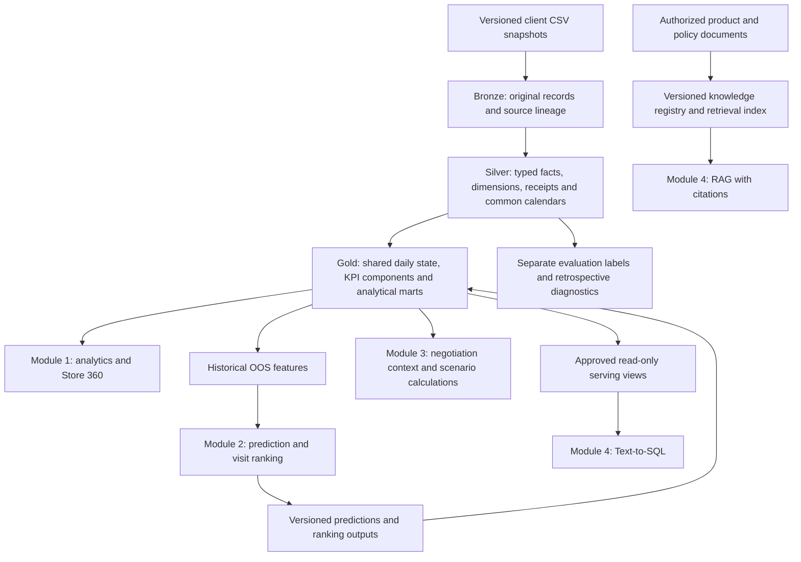

# V3 Shared Medallion Data Architecture

Design date: 2026-10-18. Implementation status: stages 1-2 are implemented in [data_platform](../../data_platform/README.md). Gold transformations, model release and application serving remain planned.

This is the common analytical foundation for Module 1 (commercial analytics), Module 2 (OOS and visits), Module 3 (negotiation), and Module 4 (SQL and knowledge assistance). Each module consumes governed outputs; source interpretation and KPI formulas are owned by the platform.

References: [product requirements](../product/product-requirements-and-user-workflow.md), [KPI/missing-day contract](../solution-specifications/kpi-and-missing-store-day-handling.md), [machine-readable V3 source contract](../../data_platform/contracts/v3/sources.json). The older [six-table dictionary](data-dictionary-and-analytical-data-model.md) is historical. Existing `ETL/` and Module 1 remain unchanged by this design.

## 1. Architecture and boundaries



The prediction arrow back to Gold is an output publication step, not a dependency of its own training features. RAG knowledge is an additional source family; the eight CSVs cannot supply missing product claims or objection-handling documents.

Use DuckDB locally for relational transformations. Medallion defines responsibilities, independently of the database engine or future AWS service choice. First implement deterministic batch rebuilds of a versioned snapshot; incremental scheduling, Airflow, streaming and AWS deployment are later work.

## 2. Storage, lineage and publication

All generated data stays in ignored paths:

```text
data/raw/                                     current authorized client CSVs
data/raw/_snapshots/v3/<dataset_hash>/         immutable copies of the eight inputs
outputs/v3/platform/builds/<build_id>/         candidate DuckDB files and quality reports
outputs/v3/platform/published/                manifest pointing to accepted artifacts
outputs/v3/platform/evaluation/               restricted labels and evaluation evidence
outputs/v3/platform/serving/                  Gold-only application snapshot
outputs/v3/platform/models/<model_version>/   model, threshold and estimator artifacts
```

The exact filenames are implementation details; lineage and isolation below are required. Publish immutable artifacts, not a partially updated live database. One writer builds a candidate version and runs checks; apps open the accepted serving snapshot read-only. Promote a manifest atomically only after checks succeed; retain the previous accepted manifest for rollback. Do not delete a previous good build on failure.

The build database contains `meta`, `bronze`, `silver`, and `gold` schemas. User-created scenario records live separately under `app`; evaluation labels and future diagnostics are stored in a separate restricted artifact. The serving file contains only approved business relations and views. DuckDB schemas are organizational boundaries, not authorization boundaries.

| Identifier | Meaning |
| --- | --- |
| `data_version` | Semantic client revision, initially `v3` |
| `dataset_hash` | Digest of the ordered filenames and file hashes, not just a version label |
| `ingestion_run_id` | One load attempt, including failed attempts |
| `build_id` | One transformation execution with input snapshot, code revision and configuration |
| `transform_version` | Version of state/estimation rules |
| `feature_version`, `model_version`, `ranking_policy_version` | Separate model lifecycle identifiers |
| `event_date` / source date | When business activity occurred |
| `source_known_at` | When the record became available; assumed only when explicitly flagged |
| `ingested_at` | When this pipeline received the file; not a proxy for historical availability |

Repeated source hashes create no duplicate Bronze records. Repeated builds with identical input and configuration produce the same business values, while execution metadata may differ. Keys below are scoped by dataset/build as specified; never join different versions by ID alone.

## 3. Source contract and Bronze

The JSON source contract specifies all eight headers, logical Silver types, nullable fields and natural keys. Its expected row counts identify this delivery, not permanent limits for future revisions. Extra/missing columns require a deliberate contract revision. Key, type and relationship failures are retained in quality results and block Silver publication.

| Bronze relation | Source grain | Natural key within a snapshot |
| --- | --- | --- |
| `bronze.dim_stores` | Account | `store_id` |
| `bronze.dim_products` | SKU | `sku_id` |
| `bronze.dim_guardrails` | Channel-category rule | `channel, category` |
| `bronze.dim_promotions` | Campaign | `promo_id` |
| `bronze.fact_sell_in` | Invoice line | `transaction_id` |
| `bronze.fact_deliveries` | Delivery event | `delivery_id` |
| `bronze.fact_execution_audits` | Audit observation | `audit_id` |
| `bronze.fact_sell_out` | Observed account-SKU-day | `date, store_id, sku_id` |

Bronze retains source column names and text values without imputing or dropping rows, plus `dataset_hash, source_file_hash, source_row_number, ingestion_run_id, ingested_at`. Physical row identity is `(dataset_hash, source_file, source_row_number)`; duplicate natural keys remain detectable rather than being silently deduplicated. Source files are byte-preserved in the snapshot. CSV parser rules and null tokens are versioned.

Metadata relations:

| Relation | Key | Required information |
| --- | --- | --- |
| `meta.ingestion_runs` | `ingestion_run_id` | Version/hash, start/end, source location, status |
| `meta.source_files` | `ingestion_run_id, filename` | SHA-256, bytes, parsed rows, header, contract version |
| `meta.build_runs` | `build_id` | Dataset, config hash, code revision, parent artifacts, outcome |
| `meta.quality_results` | `build_id, check_id, scope_id` | Pass/fail, severity, counts, tolerance, evidence reference |
| `meta.publications` | `publication_id` | Accepted build, artifact hashes, quality status, previous publication |
| `meta.policy_registry` | `policy_id, policy_version` | Approval status, effective interval, assumptions and provenance |

## 4. Silver catalog

All Silver rows carry `dataset_hash` and source lineage. Derived relations also carry `build_id`; listed keys are business keys within that immutable build. Use DATE for business days, TIMESTAMP for known-at/run times, BIGINT for source unit counts, DECIMAL for financial amounts, and DOUBLE for modeled estimates/probabilities. Preserve raw values alongside a named normalized field if normalization changes a value.

| Relation | Grain / key within build | Transformation and purpose |
| --- | --- | --- |
| `silver.dim_stores` | `store_id` | Typed account attributes; flag Distributor scope |
| `silver.dim_products` | `sku_id` | Trade cost/list price, consumer reference price, global MSL flag |
| `silver.dim_guardrails` | `channel, category, rule_version` | Preserve source rules and explicit approval/interpretation status |
| `silver.dim_promotions` | `promo_id` | Typed inclusive schedule and channel/category scope |
| `silver.fact_sell_in` | `transaction_id` | Invoice event; preserve total/extra discount and source violation flag separately |
| `silver.fact_deliveries` | `delivery_id` | Typed logistics event with ordered and realized fields |
| `silver.fact_sell_out` | `date, store_id, sku_id` | Observed facts only; retain restock fields and consumer price |
| `silver.fact_execution_audits` | `audit_id` | Audit evidence, original date and SKU allocation share |
| `silver.active_assortment` | `store_id, sku_id, effective_from` | Effective-dated membership, provenance and static-simulation assumption |
| `silver.store_sku_calendar` | `date, store_id, sku_id` | Active pairs × explicit date range; reporting flags and expected denominators |
| `silver.replenishment_events` | `delivery_id` | Receipt event linked to zero/one observed restock; preserve receipts on unreported days |
| `silver.order_schedule_events` | `delivery_id, schedule_version` | Projection of order date, planned date, ordered units and known-at; no realized fields |
| `silver.promotion_calendar` | `date, channel, category, promo_id` | Eligible campaign membership, known-at and conflict flag; retain overlaps |
| `silver.execution_latest_asof` | `date, store_id, sku_id` | Latest eligible audit, its ID/date, age and expiry status |
| `silver.inventory_reconciliation` | `date, store_id, sku_id` | Consecutive observed inventory identity and restock match diagnostics |
| `silver.bridge_rep_store` | `rep_id, store_id, effective_from` | Versioned approved or explicitly synthetic assignment, if configured |

`silver.execution_latest_asof` is materialized only over the authorized application/development date range. Retrospective gap-closure residuals use a separate evaluation relation, because they require a future report.

### V3 semantics that affect every module

- Delivery **does not contain `transaction_id` or `invoice_date`**. There is no justified one-to-one Sell-in/Delivery join. Shared store/SKU/date proximity is not a source key.
- Positive `restock_units` requires `restock_delivery_id`; validate matching Delivery date, store, SKU and units. The same receipt is counted once, using Delivery as the event source and Sell-out as corroboration.
- Unlinked Delivery is valid when its Sell-out day is missing. Keep it as a known receipt; do not create an observed sales/OOS record.
- `delay_days = actual_delivery - scheduled_delivery`; Early is -1, On Time is 0, Short Ship iff delivered < ordered. Fill-rate tolerance is 0.00501 percentage points at stored two-decimal precision, with zero relative tolerance. Zero ordered units is an explicit exception, not division by zero.
- Observed `is_out_of_stock` equals zero end-of-day inventory. Consecutive observed inventory must satisfy `inventory_t = inventory_(t-1) - sales_t + restock_t`.
- Invoice dates are Mondays after the source sales week. Keep official invoice dates; use a separate labeled source-week diagnostic rather than moving commercial history.
- Campaign discounts affect consumer price. Invoice discount affects trade price. Source `guardrail_violation` is not a substitute for approved platform policy.
- Shelf allocation sums to 100% per store/date/category within 0.031 percentage points. It is not a measured Marvel-versus-competitor share.
- Customer ZIP guardrail changes are unapproved. Keep the retained dimension and expose `rule_status = Requires review` until rule version and discount interpretation are confirmed. This does not block valid inventory analytics.

### Missing state and demand

`silver.store_sku_calendar` creates missing rows with null observed measures. The candidate estimator uses prior weekday history, a prior 28-calendar-day median, and historical-only group fallback, with versioned promotion adjustment. `gold.mart_store_sku_daily` stores the estimates; Silver observations remain untouched.

Use `inventory_estimated = max(0, last_observed_inventory + cumulative_known_receipts - cumulative_estimated_sales)` for the initial baseline candidate, with missing-history and four-day freshness checks. This is the documented cumulative-gap convention, not a claim about intraday lost-sales recovery. Record unclipped values and compare a daily-recursive challenger separately. Reset to a new report when present. If sales history is insufficient, state remains Unknown even if some receipt quantity is known.

Artificial masking must remove a complete account-day block before recomputing rolling inputs. Natural gaps without receipts show a different simulated bridge pattern; do not assume artificial-mask error transfers unchanged. Demand lost during OOS remains a separate estimate and never replaces observed sales.

## 5. Gold catalog and four-module consumers

All Gold objects identify accepted `build_id` and the relevant transformation/metric version. Physical key columns include that build identifier plus the within-build keys below. App views pin one accepted build; joins across different builds require an explicit comparison workflow.

| Relation | Grain / key within build | Consumers | Outputs and interpretation |
| --- | --- | --- | --- |
| `gold.mart_store_sku_daily` | `date, store_id, sku_id, transform_version` | 1, 2, 3, 4 | Shared sales/inventory state, coverage, receipt, campaign and audit context |
| `gold.mart_store_day` | `date, store_id, metric_view` | 1, 2, 4 | MSL states, assessable counts, OOS components, coverage; aggregate numerator/denominator |
| `gold.mart_commercial_period` | `period_type, period_start, store_id, sku_id, metric_view, alignment_basis` | 1, 3, 4 | Invoice/consumer units, financial totals, gap, discount/margin components |
| `gold.mart_execution_visit` | `store_id, audit_date, category, sku_scope_id` | 1, 3, 4 | Visit-level shelf allocation and compliance counts; scope retained |
| `gold.features_oos_daily` | `scoring_date, store_id, sku_id, feature_version, estimator_version` | 2 | Inventory, demand trajectory, past OOS/coverage, known campaigns and pending orders |
| `gold.predictions_oos` | `scoring_run_id, scoring_date, store_id, sku_id` | 1, 2, 3, 4 | Probability, threshold decision, drivers, model/feature version and input status |
| `gold.mart_visit_priority` | `scoring_run_id, store_id, ranking_policy_version` | 1, 2, 4 | Store-level MSL/risk/impact components, deterministic rank and explanations |
| `gold.mart_negotiation_context` | `as_of_date, store_id, sku_id, rule_version` | 3, 4 | Trade price/cost, actual discount history, demand, execution and policy status |

`metric_view` is `reported_only` or `operational_estimate`. `alignment_basis` distinguishes official event dates from a labeled source-week diagnostic. Aggregation may use day/week/month views, but each materialization declares its exact period and dimensions. Unknowns and zero denominators never silently become zero rates.

### Central daily state: required columns

| Group | Columns |
| --- | --- |
| Identity | `build_id, dataset_hash, data_version, date, store_id, sku_id, transform_version` |
| Observations | `units_sold_observed, inventory_observed, oos_observed, restock_units_observed, restock_delivery_id, consumer_price_observed` |
| Reporting | `is_store_day_reported, sales_is_observed, inventory_is_observed, last_report_date, days_since_inventory_report` |
| Estimates | `units_sold_estimated, inventory_estimated, sales_estimation_method, inventory_estimation_method, estimator_version` |
| Resolved inputs | `sales_model_state, inventory_model_state, sales_data_status, inventory_data_status, oos_estimated` |
| Receipt lineage | `receipt_units_from_deliveries, receipt_delivery_count, receipt_set_id` |
| Context | `channel, region, segment_tier, category, is_msl, promo_set_id, last_audit_id, days_since_last_audit` |
| Availability | `as_of_timestamp, availability_assumption_id, source_lineage_set_id` |

Status values are Observed, Estimated, Unknown. Estimates remain null on observed rows; resolved fields choose observed first, then an eligible estimate, otherwise null. `oos_estimated` derives only from an eligible inventory estimate and is never a training label. Collection identifiers resolve to lineage/membership bridges, so multiple receipts/campaigns do not multiply daily rows.

### Module-specific use of shared rules

**Module 1:** uses state, commercial and audit marts. MSL has Compliant/Noncompliant/Unknown states with assessment coverage and bounds. Operational and reported rates are explicit. The dashboard consumes numerator/denominator components and does not independently re-impute inventory.

**Module 2:** consumes historical features, publishes predictions and visit priorities. Risk probability is not expected lost units. `units_at_risk_estimated` requires a separately versioned demand/shortfall calculation; `trade_value_at_risk_estimated` needs an explicit price basis. If not validated, publish null with a reason. Do not multiply all SKU probabilities as though they were independent to claim a calibrated store-level OOS probability. Store maximum probability can be a labeled ranking component.

**Module 3:** receives shared price, cost, execution, demand and rule context. `net_trade_price = list_price × (1 - proposed_total_discount_pct/100)` and `margin_pct = 100 × (net_trade_price - unit_cost)/net_trade_price`, undefined when net price is zero. If proposal type is additional discount, require an approved composition rule; do not guess additive versus compounded treatment. Unresolved guardrails produce Requires review. Source observations, user assumptions and simulated outcomes are separate fields.

**Module 4:** NLQ uses approved serving views; RAG uses an authorized knowledge registry/index. Both can cite the relevant publication or document version. Module 4 shares metric definitions with the other modules and does not generate its own alternative KPI SQL against raw tables.

## 6. Additional product and model outputs

These are not client facts and must not be inserted into Bronze as if supplied by the customer.

| Relation/artifact | Key | Required information |
| --- | --- | --- |
| `meta.model_registry` | `model_version` | Feature/estimator version, training cutoff, parameters, threshold, artifact hash, evaluation provenance |
| `app.negotiation_scenarios` | `scenario_id` | Actor/context, creation time, publication, assumption/rule version, status |
| `app.negotiation_scenario_lines` | `scenario_id, line_id` | SKU, volume, proposed discount type/value, cost/price snapshot, simulated results |
| `app.visit_outcomes` (later) | `visit_id` | User-entered event and timestamps, linked recommended action and actual follow-up |
| `knowledge.documents` | `document_id, document_version` | Authorized URI/hash, title, effective dates, scope, permission and provenance |
| `knowledge.chunks` | `document_id, document_version, chunk_id` | Citation location, content hash, retrieval/embedding version |

Scenario saving and visit feedback are explicit app writes outside read-only marts. RAG index build and a 10-NLQ/10-RAG evaluation set belong to Module 4 implementation; this design supplies their data contract without inventing absent documents.

## 7. Time rules and evaluation isolation

Historical features use only events and estimators legitimately available by the scoring timestamp. An ingestion timestamp in October cannot establish availability in March. Static same-day known-at assumptions are recorded per source. In a live system, event and known-at dates may differ and schedules require revision history.

1. The current order-schedule projection contains only `delivery_id, store_id, sku_id, order_date, scheduled_delivery, units_ordered` and a declared known-at assumption. Pending status at `t` is determined by posted receipts by `t`; future actual status/quantity/date cannot be read by the feature query.
2. Retain orders known before the development cutoff even if their outcome occurs in June. Project authorized planned fields before exposing records to the development feature builder; keep realized outcomes in the restricted source/evaluation artifact. A record's eventual arrival month is not a valid feature filter.
3. Resolve audits backward as-of; resolve campaign schedules from their known plan; fit demand fallback and promotion factors on historical data only. Future labels and gap-closure diagnostics are separate dependencies.
4. Build complete-window labels in `evaluation.labels_oos_next7`: target 1/0 only when all seven future Sell-out dates are observed. Otherwise target is null; partial observed positives may be recorded as metadata but do not enter the baseline.
5. Keep exact March/April/May split and purge boundaries from the KPI specification. June outcome analytics and final model evaluation remain unreleased until configuration/model freeze.

The published notebook May output (Precision 0.9302, Recall 0.7208, ROC-AUC 0.9914) is an experimental reference. Full-panel fallback statistics, precomputed masked rolling features, unrestricted gap length, and boundary-order omission require correction as described in the KPI specification. First reproduce the old baseline separately, then report the corrected pipeline's own results. Do not force new metrics to equal a flawed baseline.

## 8. Serving views and controlled NLQ

| View | Grain and scope | Consumers |
| --- | --- | --- |
| `serving.vw_store_sku_daily` | Date/account/SKU for the accepted build | Store 360; approved detailed NLQ |
| `serving.vw_store_day` | Date/account/view | Dashboard, managers, NLQ |
| `serving.vw_commercial_period` | Period/account/SKU/view/alignment | Dashboard, simulator, NLQ |
| `serving.vw_execution_visits` | Visit/category/SKU scope | Dashboard, simulator, NLQ |
| `serving.vw_oos_predictions` | Explicit scoring run/date/account/SKU | Risk and NLQ |
| `serving.vw_visit_priority` | Explicit scoring run/account/ranking version | Visit planning and NLQ |
| `serving.vw_negotiation_context` | As-of/account/SKU/rule version | Simulator and policy NLQ |
| `serving.vw_metric_definitions` | Metric/version | Shared formula, denominator, units, view and limitation metadata |

The app selects an authorized publication, scoring run and account scope explicitly; it does not silently combine multiple runs. Field representatives see effective assigned accounts, managers see their configured region, and missing assignments remain explicit. Demo assignments are deterministic, versioned and visibly synthetic.

For NLQ, open the serving snapshot read-only, validate a single SELECT against an allowlist of views/functions, apply account/region restrictions through a controlled query layer, and reject file/network readers, extension loading, writes, attachment and unrestricted SQL. Read-only connection mode alone is insufficient. The application has no connection path to evaluation artifacts, Bronze files or private knowledge sources.

## 9. Quality gates and failure behavior

| Gate | Hard requirements | Result on failure |
| --- | --- | --- |
| Bronze acceptance | All files, hashes, expected header contract, parse accounting | Retain snapshot/evidence; no typed promotion |
| Silver structural | Types, natural-key uniqueness, required references, nonnegative measures, valid dates/categories | Record offending rows/keys; no accepted Silver/Gold build |
| Receipt contract | Explicit restock FK, matching dimensions/date/units, consecutive inventory identity, explained unlinked receipts | Disable receipt-based estimate publication; retain last accepted snapshot |
| Commercial arithmetic | Gross/net formulas at currency tolerance, source-consistent fill rate, campaign price/discount checks | Block affected data build; retain raw evidence |
| Shared transformations | Grain/cardinality, effective assortment, no double counting, as-of/past-only inputs, four-day state limit | Block Gold publication |
| KPI semantics | MSL Unknown handling, aggregate components, shelf-allocation scope, N/A on zero denominator, channel scope | Block affected serving mart |
| Model release | Corrected masking, complete-window labels, temporal split, development/May metrics, model/threshold freeze | Keep model candidate; descriptive marts may still publish |
| Policy readiness | Approved guardrail version and interpretation | Publish context with Requires review; withhold automatic scenario approval |

For each gate record pass/fail, severity, numerator/denominator, tolerance and evidence. Row counts alone are not sufficient. Structural failures never turn into silent dropped rows. Record warnings for unusual missing rates, stale audits and shifted segment prevalence without inventing source truth.

## 10. Implementation sequence and acceptance

| Stage | Deliverable | Completion evidence |
| --- | --- | --- |
| 1 | Ingestion/metadata, versioned snapshots, Bronze | Eight headers verified; hashes/rows captured; repeat load does not duplicate records |
| 2 | Typed Silver sources, receipt reconciliation and calendar | Natural keys/FKs pass; inventory identity; no fan-out; missing rows remain null |
| 3 | Historical estimator and shared daily state | Corrected 1-4-day account-block masking, cold-start/freshness checks, interval diagnostics |
| 4 | Shared commercial/audit/store KPI marts | Manual fixtures for denominators, periods, decimals, Unknown and receipt double-counting |
| 5 | OOS features, restricted labels and model outputs | Baseline replay and corrected March/April/May experiments; June remains locked |
| 6 | Negotiation context, scenario contracts, policy checks | Financial examples match; unresolved rules return Requires review; Distributor handling explicit |
| 7 | Serving snapshot and NLQ/knowledge contracts | Cross-module metric parity, account scope, query restrictions, no restricted label access |

Implementation notes for stages 1-2:

- The internal build file contains full Bronze snapshots; realized Silver facts stop at the authorized development cutoff. Header/type/key checks across the complete input are ingestion integrity checks, not June outcome evaluation. No application or model feature connection to this internal file is provided at this stage.
- `published/silver.json` publishes a validated pipeline handoff only, with `application_ready = false`. A Gold-only serving file and controlled feature projections must be completed before application/model integration.
- `silver.promotion_calendar` is also implemented. `execution_latest_asof` and representative assignment materialization remain subsequent work.
- Static assortment calendar rows retain first-observation availability through `assortment_is_confirmed_asof`. Historical features must exclude unconfirmed membership unless an approved initial registry establishes it. Snapshot `last_observed_date` is not a historical feature.
- Campaigns are conservatively assumed known at their start; initial schedules are assumed known at order date. Neither assumption establishes production availability or schedule revision history.

Design-approved does not mean source ambiguities are resolved. Guardrail meaning, MSL applicability, audit expiry, campaign precedence/minimum-volume grain, representative assignments, value-at-risk basis and production availability remain recorded policy decisions. Valid marts may be published with explicit Unknown or Requires review states while those decisions are pending.

The next implementation stage is the corrected historical estimator and shared Gold daily state, validated with account-day block masking before adoption. Existing Aiven ETL and the Module 1 app are outside this implementation's initial scope.
