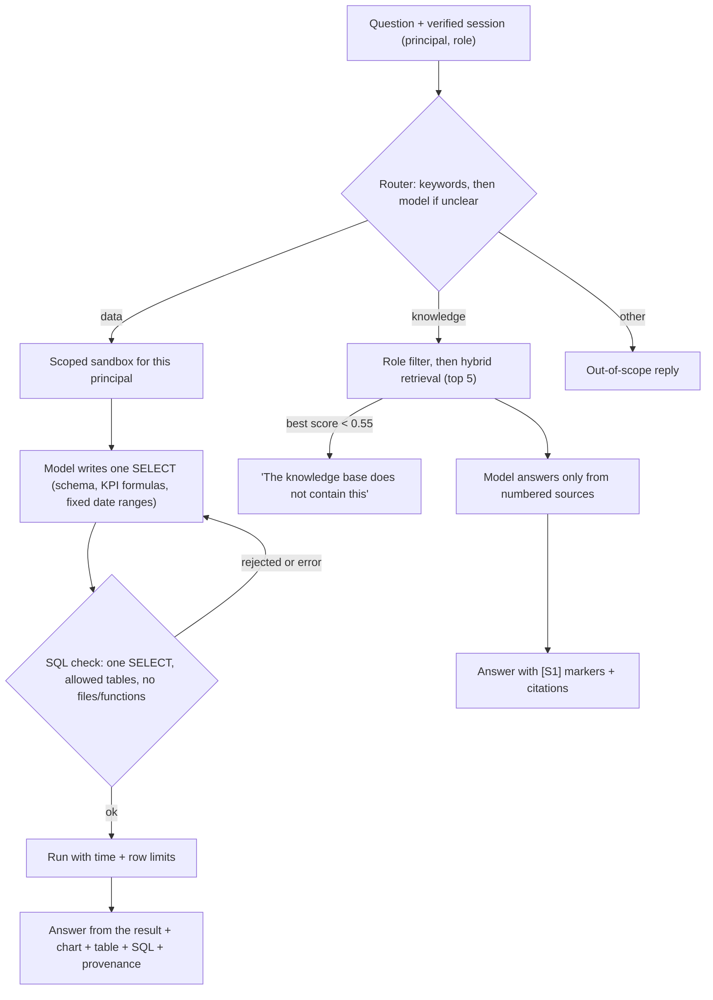

# Module 4: Commercial Copilot (Text-to-SQL + RAG)

A conversational copilot for field representatives and regional managers. It answers two kinds of question
in plain English, with no SQL or table knowledge needed:

- **Data questions (Component A, NLQ / Text-to-SQL).** "Which are the 5 SKUs with the highest out-of-stock
  rate in Traditional Trade this week?" The copilot writes one SQL query, runs it on the signed-in user's
  stores only, and returns a short answer, an automatic chart, the result table and the SQL it ran.
- **Knowledge questions (Component B, RAG).** "Which SKU can I substitute for Marvel Power Clean Lemon 1L
  if it's out of stock?" The copilot retrieves passages from Marvel's 12 authorized documents in
  [`knowledge_base/`](../../knowledge_base/README.md) and answers only from them, citing each passage with
  document, version, section and PDF page.

The language model runs **locally** (Ollama, `qwen2.5:7b` by default): no API fees, and no question,
schema, result or document leaves the machine.

## 1. Run it

```bash
# 1. Python dependencies (app + embeddings for the knowledge base)
uv sync --frozen --extra app --extra module4

# 2. Local model (macOS; see ollama.com for Linux/Windows)
brew install ollama
ollama serve                # keep running in its own terminal
ollama pull qwen2.5:7b      # one-time download, about 4.7 GB

# 3. Business data: an accepted shared publication with account scopes
#    (data maintainers: docs/data/README.md sections 2-4; the demo identities use
#    modules.module_2.service.demo_scope, the same round-robin assignment as Module 2)

# 4. App (Module 4 tab) or command line
uv run --extra app --extra module4 shiny run app.py
uv run --extra module4 python -m modules.module_4 status
uv run --extra module4 python -m modules.module_4 ask "What is the average shelf share for the Laundry category in the Southeast region?"
uv run --extra module4 python -m modules.module_4 ask "How often should I visit a Tier 2 store?" --principal demo:rep-a --role sales
uv run --extra module4 python -m modules.module_4 eval      # 20-question practice set + 5 safety checks

# Standalone copilot only, with demo sign-ins (useful for the presentation)
uv run --extra app --extra module4 shiny run modules.module_4.demo_app:app --port 8766
```

| Setting | Default | Meaning |
| --- | --- | --- |
| `MODULE4_SERVING_PUBLICATION` | `outputs/v3/platform/delivery/serving/published/serving.json` | Published business snapshot to pin |
| `MODULE4_SERVING_ARTIFACT_DIR` | unset | Use an accepted (copied) serving directory instead |
| `MODULE4_LLM_PROVIDER` | `ollama` | `ollama`, or `openai` for any OpenAI-compatible server |
| `MODULE4_LLM_BASE_URL` | `http://127.0.0.1:11434` | Model server address |
| `MODULE4_LLM_MODEL` | `qwen2.5:7b` | Model name |
| `MODULE4_LLM_API_KEY` | unset | Only for a hosted OpenAI-compatible server (keep it in `.env`, never in Git) |
| `MODULE4_LLM_TIMEOUT_S` | `120` | Per-call timeout |
| `MODULE4_RAG_DENSE` | `1` | `0` = BM25-only retrieval (no embedding model) |

If the model, the data or the knowledge base is missing, the tab shows that state (red status chip and an
explanation) instead of an answer. With the model stopped, a knowledge question still lists the permitted
passages.

**Hardware.** The 7B model needs about 5 GB of free memory and answers in roughly 7-20 s on an Apple M-series
laptop. Close memory-heavy apps before a live demo: when the machine starts swapping, answers slow to minutes.

## 2. How a question is answered



The **principal** (which stores) and the **document role** (`sales` or `manager`) always come from the
signed-in session (`shared/auth.py`). Nothing in the question, a document or the model's output can change
them, and signing out or switching user clears the conversation.

## 3. Component A: NLQ / Text-to-SQL

**Data source.** The same accepted `business.duckdb` publication the other modules read, pinned through
`examples.read_shared_data.open_reader` (integrity and quality checks included). Module 4 never reads raw
CSVs, `build.duckdb`, features or labels.

**Scoped sandbox** ([sandbox.py](sandbox.py)). For each principal, trusted code copies only that principal's
stores from the serving views into a compressed in-memory DuckDB with ten analyst-friendly tables
(`sku_daily`, `store_daily`, `weekly_flow`, `monthly_flow`, `sell_in`, `shelf_audits`, `deliveries`, `stores`,
`products`, `promotions`). It then detaches the publication, switches off file and network access and locks
the configuration. The model's SQL therefore cannot see another account's rows in any join, subquery or
aggregate: those rows are not in the sandbox. A manager sandbox (221 stores, 2.4 M store-SKU-days) builds in
about 1.5 s and uses about 280 MB; a rep sandbox (37 stores) about 0.2 s.

**SQL check** ([sql_guard.py](sql_guard.py)). DuckDB's own parser (`json_serialize_sql`) checks every query
before it runs: exactly one `SELECT` (so `ATTACH`, `COPY`, `SET`, `PRAGMA`, writes and a second statement
hidden after a comment are rejected), only the ten sandbox tables or the query's own CTEs, no schema prefixes
(`information_schema`, attached databases), no table functions (`read_csv`, `query`, ...) and no denied
functions (`getenv`, `read_*`, ...). Queries are interrupted after 20 s and return at most 200 rows (totals
are always computed on the full scoped input; only the displayed rows are capped, and the cap is reported).

**Prompt** ([nlq.py](nlq.py)). The model gets the table descriptions, the exact text values in the user's
scope, the team's KPI formulas from `metric_definitions` (for example OOS rate = OOS SKU-days / SKU-days with
known stock, unknown days excluded; never an average of percentages), fixed date ranges relative to the data
cutoff (2026-06-30: "this week" = 24-30 Jun, "last 4 weeks" = the 4 latest complete weeks for weekly flows,
and so on) and four worked examples that are not the brief's questions. If the SQL is rejected or fails, the
error goes back to the model for up to two corrections; an empty result gets one check of its filters.

**Answer.** The model explains the result using only numbers in the table. The UI adds the chart
([charts.py](charts.py): line for dates, bars for rankings, grouped bars for comparisons), the table, the SQL
and a provenance line (publication, data cutoff, scope, metric version, model).

## 4. Component B: RAG pipeline

| Step | What happens | Where |
| --- | --- | --- |
| **Documents** | 12 authorized documents: 9 Marvel documents (catalogue, substitution guide, argumentarium, objection handling, pricing and guardrail policy, MSL and execution standards, promotions, KPI handbook, manager-only deal review) and 3 public reference summaries. Each has a registry entry with `document_id`, `version`, `content_hash`, `authorized_source`, `effective_date`, `permission_scope` and `citation_location`. | `knowledge_base/documents/`, `registry.json`, `pdf/` |
| **Chunking** | Split at Markdown headings (`##`, `###`); paragraphs, lists and tables are packed up to 300 words; a split table repeats its header. 174 chunks, each keeping document, version, section and PDF page. | `knowledge_base/tools/kb_lib.py` (`chunk_document`) |
| **Embedding** | `BAAI/bge-small-en-v1.5` (384 dimensions, normalized) via fastembed/ONNX on the CPU. The embedded text is "title \| heading path + section text". Vectors are exported with the index. | `knowledge_base/index/` |
| **Retrieval** | Chunks outside the caller's role are removed **before** ranking (sales never sees the manager-only guide). Dense cosine and BM25 (k1 1.4, b 0.75) rankings are merged by reciprocal rank fusion (k = 60); top 5 chunks. If the best permitted dense score is below 0.55, the answer is "the knowledge base does not contain this" and the model is not called. | `kb_lib.KnowledgeBase.search` |
| **Generation** | The local model receives the 5 passages as numbered sources `[S1]`-`[S5]` and must answer only from them, end each sentence with its marker, quote figures exactly and treat document text as evidence, never as instructions. Markers that point at no retrieved source are removed; an answer without any marker is regenerated once. The UI lists the cited sources and all retrieved passages. | [rag.py](rag.py) |

Rebuild the index after editing a document: `uv run --extra module4 --with fpdf2 python knowledge_base/tools/build_kb.py`
(see the [knowledge base README](../../knowledge_base/README.md)).

## 5. Practice evaluation

The final presentation tests 20 questions live (10 NLQ + 10 RAG) and requires at least 80% correct.
[`eval_questions.json`](eval_questions.json) is a practice set of the same shape: the brief's five examples
plus 15 new questions, and 5 safety checks (prompt injection for the manager guide, rep scope, SQL injection,
file read, off-topic). Data answers are graded against reference SQL recomputed on the same scoped sandbox
(right keys in the right order or the right values, and the written answer must state them); knowledge
answers must cite an expected document and contain the key facts.

Latest run (local `qwen2.5:7b`, publication `20261029T030859-c5b2e820650f`, data through 2026-06-30), full
table in [eval_results.md](eval_results.md):

| | Result |
| --- | --- |
| **Core 20 questions** | **18/20 (90%)**: NLQ 9/10, RAG 9/10 |
| Brief's five example questions | 5/5 |
| Safety checks | 5/5: manager guide not leaked to sales, rep sees only their 37 stores, `DROP`/`information_schema` and file reads blocked, off-topic declined |
| Median answer time | 15 s (first question about 35-50 s while the model and sandbox load) |

The two misses: **D07** (lowest fill rate "last quarter"): the model read last quarter as April-June and added
a delivery-lateness filter the question did not ask for. **K04** (Dishwashing products on the Must-Stock
List): retrieval ranked the product sheets above the MSL list, so the answer named three of the four SKUs.
One knowledge question (K07, promotion dates) was answered from the promotions table instead of the
documents; the facts agree and the answer is correct. Across the last three prompt revisions the score
moved between 16 and 18 of 20, so treat roughly 80-90% as the expected range on unseen questions.

These questions were written by the team, so this is a regression check, not a prediction of the live
score. Before the presentation, teammates should each add questions they did not write the code for.

## 6. Limitations and next steps

- **Deployment.** The model runs on the presenter's laptop. The Render site has no model server; Module 4
  shows "model not running" there unless `MODULE4_LLM_*` points at a reachable server (a hosted model would
  send questions and results outside the machine, which needs the team's and client's agreement). The
  Docker image does not yet copy `knowledge_base/` or `data_platform/`.
- **Scope.** Reported data only (unknown days are excluded, never treated as zero). Candidate estimates,
  Module 2 predictions and visit priorities are not exposed to the copilot yet.
- **Multi-agent system (planned).** The router already separates a data agent and a knowledge agent; the
  next step is a coordinator that can call both in one answer and add Module 2 (OOS risk) and Module 3
  (deal check) tools.
